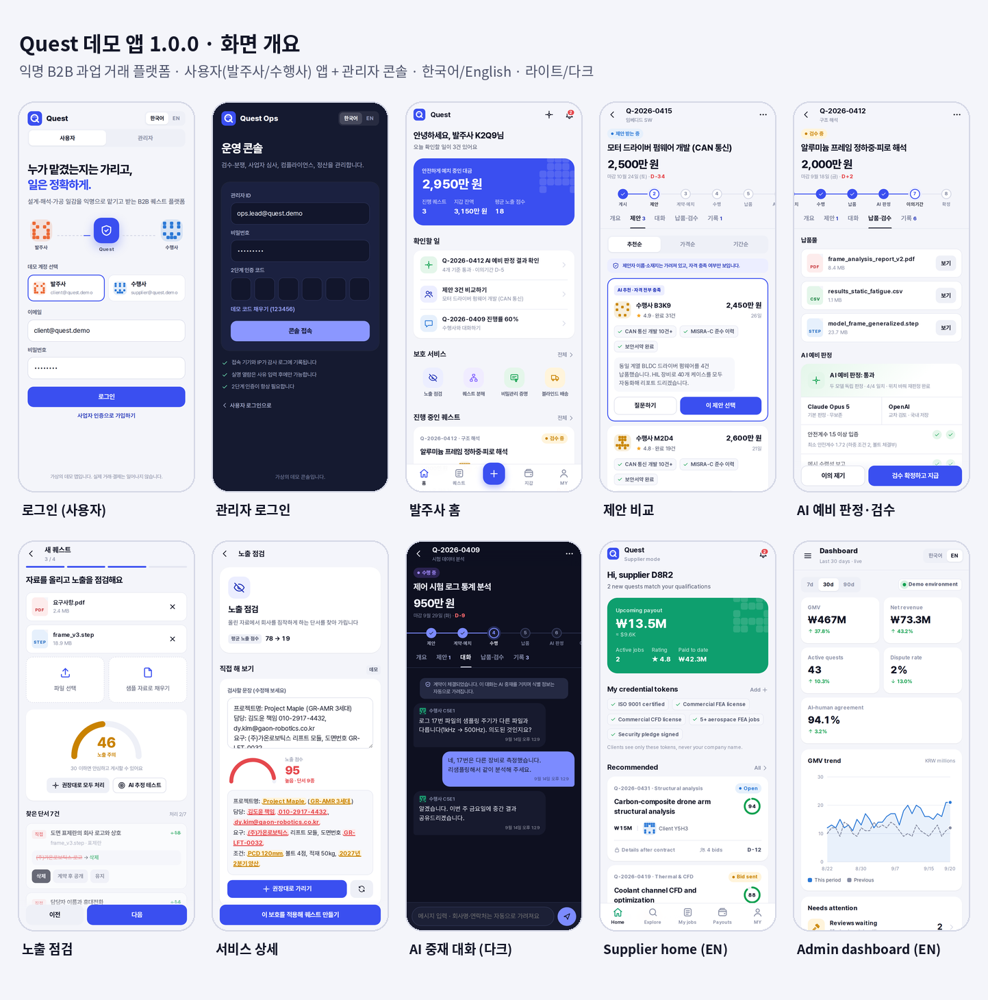

# Quest Demo

익명 B2B 과업 거래 플랫폼 "퀘스트"(가칭)의 가상 데모 앱입니다. 발주사·수행사 앱과 관리자 콘솔을 한 앱에 담았고, 서버 없이 기기 안의 가상 데이터로 모든 기능이 실제처럼 반응합니다. 한국어/English, 라이트/다크 모드를 지원합니다.

A fictional demo of "Quest", an anonymous B2B work exchange. Client and supplier apps plus an admin console, all running offline on mock data. Korean/English, light/dark.



## 데모 계정

| 역할 | 로그인 |
|---|---|
| 발주사 / 수행사 | 로그인 화면에서 계정 선택 후 "로그인" |
| 관리자 | "관리자" 탭 → "데모 코드 채우기"(2단계 인증 123456) |

MY → "데모 데이터 초기화"로 처음 상태로 돌아갑니다.

## 구성

```
web/        앱 본체 (HTML/CSS/JS, Pretendard 글꼴, 외부 라이브러리 없음)
android/    WebView 셸 (순수 Java), 매니페스트, 리소스, 아이콘
build.sh    Gradle 없는 빌드: aapt2 → javac → D8 → zipalign → apksigner
tests/      smoke.py(전 경로), e2e.py(흐름 12개 × 한/영), jvm/(JUnit + Robolectric)
```

## 웹으로 미리 보기

```bash
cd web && python3 -m http.server 8765
# http://127.0.0.1:8765/index.html
```

## APK 빌드

필요: JDK 17 이상, Android SDK의 `build-tools;34.0.0`, `platforms;android-34`.

```bash
export ANDROID_HOME=~/Android/Sdk   # 또는 SDK / BT / AJ 개별 지정
./build.sh                          # → dist/QuestDemo-1.0.0.apk
```

- D8/R8 8.13.23은 첫 빌드 때 `.tools/`로 자동으로 받습니다.
- 서명 키는 저장소에 없습니다. `keystore/questdemo.jks`가 없으면 데모 키를 새로 만듭니다. 이미 설치된 앱을 업데이트하려면 기존 키를 `keystore/questdemo.jks`에 두고 빌드하세요(비밀번호는 `KS_PASS` 환경변수, 기본값 `grinda-quest`).
- GitHub Actions(`.github/workflows/build.yml`)가 푸시마다 APK를 빌드해 아티팩트로 올립니다. 기존 키로 서명하려면 저장소 Secrets에 `KEYSTORE_B64`(키 파일 base64)와 `KS_PASS`를 넣으세요.

## 테스트

```bash
pip install playwright && python -m playwright install chromium
(cd web && python3 -m http.server 8765 &) 
python3 tests/smoke.py      # 전 경로 한/영 렌더링, 콘솔 오류·가로 스크롤 검사
python3 tests/e2e.py        # 실제 탭·입력으로 흐름 12개 × 한/영
./build.sh && tests/jvm/run.sh   # 네이티브 셸 18개 (Maven 필요)
```

## 참고

- 회사명, 가명, 금액, 통계, 해시는 모두 가상 데이터입니다. 결제·블록체인·AI 호출은 일어나지 않습니다.
- 글꼴 Pretendard는 SIL Open Font License 1.1을 따릅니다 (`web/fonts/Pretendard-LICENSE.txt`).
